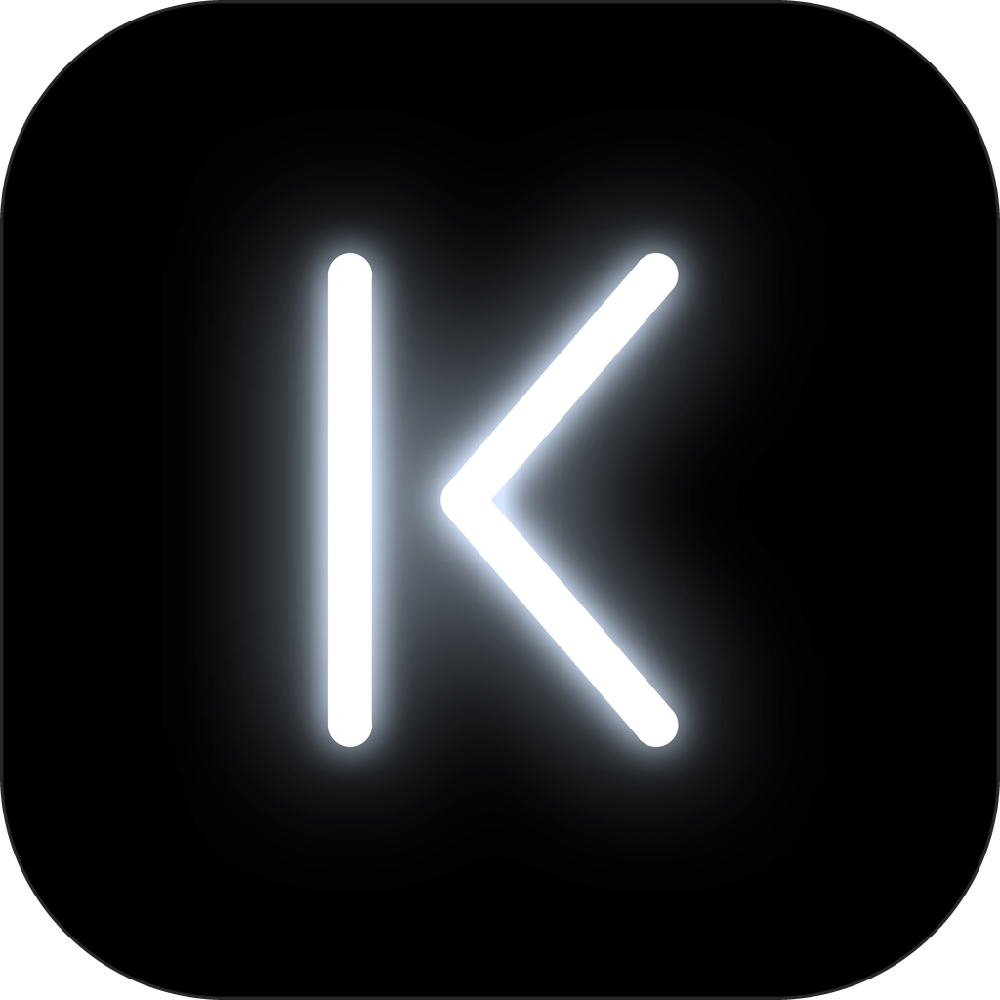

# Kordia

Um sistema que **ouve o violão** e toca junto um baixo e um pad que seguem os acordes **que estão soando**, não uma cifra pré-programada. Pensado para banda de igreja, onde não há clique, o tom muda na hora e o andamento oscila.

**Status:** app ao vivo em **C++/JUCE** (WASAPI, ~22 ms de latência de driver no modo padrão) e laboratório também em C++ (cenários, métricas, prova, reprodução de sessões). Os dois usam o mesmo núcleo; o projeto não tem Python. Detalhes, números e falhas conhecidas em [`docs/resultados.md`](docs/resultados.md).

## Instalação

**Pré-requisitos:**

- Windows 11.
- **Visual Studio 2022 ou 2026** (os *Build Tools* bastam) com a carga "Desenvolvimento para desktop com C++". O CMake vem junto.
- **Git** e internet no primeiro build: JUCE 8, pocketfft (só o laboratório) e o SDK do WebView2 são baixados pelo CMake na primeira configuração.
- Acesso ao repositório, que é privado.

**Passos**, a partir da raiz do repositório:

```bat
git clone https://github.com/MatheusPalmieri/kordia.git
cd kordia
tasks build --app           :: núcleo + laboratório + testes + app JUCE (Kordia.exe)
tasks test                  :: confere o build
tasks atalho                :: cria Kordia.lnk na raiz, o atalho com a logo
```

No PowerShell, escreva `.\tasks` em vez de `tasks`. O primeiro build pode levar alguns minutos, e `tasks build` (sem `--app`) compila só o núcleo, o laboratório e os testes.

O `tasks.bat` usa o CMake do Visual Studio mais novo instalado e, sem Visual Studio, o CMake do PATH. Se trocar a versão do Visual Studio, apague `cpp/build` e compile de novo. Se mover a pasta do projeto, faça o mesmo e rode `tasks atalho`, porque o exe e o atalho guardam caminhos absolutos.

O app em si só precisa do WebView2, que já vem no Windows 11.

**Clone novo não traz as sessões reais:** `sessoes/` fica fora do git. Sem as pastas, `tasks test` mostra `(sem sessoes/: pulado)` nos testes com o violão real, e a `prova` roda sem as variantes `real_*` e sem o controle das sessões, então a nota não é comparável com [`docs/resultados.md`](docs/resultados.md). Para comparar, copie as pastas de `sessoes/` da máquina onde foram gravadas.

## Uso ao vivo (app)

Dê dois cliques no atalho **Kordia** (`Kordia.lnk`, criado por `tasks atalho`; é um atalho porque `.bat` não aceita ícone). Ele chama `assets/abrir.bat`, que abre `cpp/build/app/KordiaApp_artefacts/Release/Kordia.exe` (compile com `tasks build --app`). O app abre numa tela de entrada com a logo, que some quando os dispositivos de áudio estiverem listados.

**Ele já ouve desde que abre:** antes do Iniciar, a tela mostra o acorde que está reconhecendo (ou a nota, se você tocar uma só) e o nível do violão, sem tocar nada e sem gravar sessão. Ao apertar **Iniciar** com BPM fixo ou Clique ligado, ele **conta 4 tempos** no clique (4, 3, 2, 1 na tela) e só começa a memorizar no compasso seguinte. Sem clique e sem BPM não há o que contar: ele começa a seguir na hora.

Em **Ajustes** aparecem **Driver** (padrão: *Windows Audio*, ~22 ms) e **Latência do driver** (padrão: ~10 ms). Use o padrão quando entrada e saída forem aparelhos diferentes (ex.: microfone USB + headset): o Windows compensa a diferença de relógio entre eles. *Windows Audio (Exclusive Mode)* só serve com uma interface de áudio única (entrada e saída no mesmo aparelho); com dois aparelhos a captura morre depois de ~15–20 s. Se algo der errado, a janela avisa no rodapé (sem sinal na entrada, rajada de falhas de áudio, entrada corrompida).

**Verificação de áudio:** com o app parado, ele consulta o Windows a cada 3 s e mostra um aviso no topo da janela, com o botão *Abrir ajustes do Windows* quando o problema se resolve lá. Em **Ajustes → Áudio**, *Entradas no Windows* lista todas as entradas conhecidas e o estado de cada uma.

| Aviso | O que fazer |
|---|---|
| Windows bloqueando o microfone | Liberar o microfone para apps da área de trabalho na privacidade do Windows |
| Entrada muda | Tirar o mudo ou subir o volume dela no Windows |
| Driver sem funcionar | Reinstalar o driver do fabricante da interface |
| Interface não conectada, app no microfone do computador | Conferir o cabo USB e se o aparelho está ligado; ao conectar, o app percebe sozinho |
| Interface conectada, app no microfone do computador | Trocar em **Ajustes → Entrada**; a escolha fica salva e volta quando o aparelho reconectar |

O app não instala drivers. Interfaces que exigem driver próprio precisam dele instalado pelo fabricante. Fones de ouvido com microfone não contam como interface, então não geram aviso.

Na tela principal ficam só o que você usa tocando: o **Tom** no topo (*Automático* = ele descobre pelos acordes e mostra qual achou), **Iniciar**, o acorde, o cartão **Sinal** (violão entrando; baixo e teclado saindo, com as notas), o **Andamento**, o **Padrão** aprendido e o **Diário** de decisões. O resto fica em **Ajustes** (botão ao lado do estado):

- **Áudio:** driver (padrão *Windows Audio*), latência do driver, entrada, saída, ganho (com medidor), ouvir o violão na saída.
- **Som:** volume (até 200 %), dinâmica fixa e **Instrumentos**: pad worship, órgão, piano elétrico, pad de guitarra, cordas e baixo, cada um com liga/desliga e volume, mudando com ele tocando.
- **Música:** *Aprender segurando a tônica* (até reconhecer o padrão, só um pad suave na tônica, sem baixo e sem ficar trocando de acorde), *Manter o padrão aprendido* (erros e atrasos não destravam; só uma mudança de 1½ compasso) e progressão conhecida. Com progressão conhecida, a grade de aprendizado não é usada.

**Andamento:** *Seguir meu tempo* ou *BPM fixo*. O botão **Clique** já inicia tudo se estiver parado: a contagem começa na hora, antes de você tocar (no modo seguir ela usa o BPM escolhido e depois ele acompanha o seu tempo). − / + mudam o BPM com ele tocando; *Fixar este BPM* congela o detectado.

**Com clique, o padrão é aprendido na grade:** ele lê a harmonia de cada meio compasso inteiro, acha o ciclo depois de ouvir 2 voltas e soma as voltas, então um compasso mal ouvido é corrigido sozinho, mesmo com o padrão já travado. As trocas caem na cabeça do tempo. Sem clique, continua o caminho antigo, que reage ao acorde ouvido.

> **Importante:** microfone + caixa de som no mesmo ambiente fazem o sistema ouvir o próprio baixo/pad (pior cenário medido). Prefira **fone** ou o violão **ligado direto**.

### Logs de cada sessão

Cada Iniciar cria `sessoes/<data-hora>/` (fora do git) com a gravação da entrada, a configuração, uma linha por bloco de 23 ms (nível, acorde ouvido, confiança, estado, BPM, custo de processamento, falhas de áudio), todas as decisões com o motivo, um resumo e um **relatório visual** gerado ao parar (`replay_<data-hora>.svg`, abre em qualquer navegador). "Abrir pasta" no rodapé leva até ela.

O relatório é gerado pelo `kordia_lab`, que o app chama ao parar. O processamento é determinístico, então uma sessão pode ser reproduzida exatamente, offline:

```bat
cpp\build\Release\kordia_lab rodar --sessao sessoes\2026-10-29_20-40-00
```

Para eu analisar um problema que você ouviu ao vivo, basta mandar a pasta da sessão (ou dizer o horário em que aconteceu).

## Uso em arquivos e avaliação

```bat
:: testes (unitários + regressão dos cenários + prova resumida), ~30 s
tasks test

:: avaliar todos os cenários (tabela de métricas + relatórios SVG), ~3 s
tasks avaliar baseline

:: prova: músicas novas nos 12 tons, com a configuração do app e o violão real das sessões, ~5 min
tasks prova dev
```

Direto no laboratório (`cpp\build\Release\kordia_lab.exe`, a partir da raiz do repositório):

```bat
:: gerar um cenário sintético (WAV + verdade-base JSON)
kordia_lab gerar --cenario acelerando --saida dados

:: rodar o acompanhante num WAV qualquer (inclusive gravação de celular)
kordia_lab rodar --entrada minha_gravacao.wav --modo livre --tom C
kordia_lab rodar --entrada gravacao.wav --modo metronomo --bpm 110 --tom C
kordia_lab rodar --entrada gravacao.wav --modo decorado --progressao "C G Am F" --tom C
```

`rodar` gera, ao lado da saída escolhida (`--saida`, padrão `saida/`):
- `<nome>_render.wav`: violão original + baixo + pad;
- `<nome>.mid` e `<nome>_eventos.json`: os eventos do acompanhamento;
- `<nome>.svg`: relatório visual (forma de onda, onsets, BPM, acordes, estado, dinâmica).

`avaliar` salva tudo em `resultados/<versao>/`.

## Estrutura

```
assets/         logo (kordia.svg é a fonte; png e ico exportados) e abrir.bat
cpp/core/       núcleo: o motor, sem JUCE; os parâmetros ficam em include/kordia/core.h
cpp/app/        app JUCE (Kordia.exe), teste de fumaça ao vivo (KordiaLiveTest.exe); ui/ = interface
cpp/lab/        laboratório (kordia_lab.exe): cenários, métricas, prova, relatórios, reprodução de sessões
cpp/tests/      testes (kordia_tests.exe)
tasks.bat       build, testes, avaliação, prova, atalho
docs/           visão, requisitos, arquitetura, riscos, testes, roadmap, decisões, resultados, glossário
dados/          cenários gerados (ignorado pelo git)
sessoes/        gravações e logs das sessões ao vivo (ignorado pelo git)
resultados/     métricas e relatórios por versão (só o CSV/JSON vai para o git)
```

## Documentação

1. [Visão](docs/00-visao.md) · 2. [Requisitos](docs/01-requisitos.md) · 3. [Arquitetura](docs/02-arquitetura.md) · 4. [Riscos](docs/03-riscos.md) · 5. [Plano de testes](docs/04-plano-de-testes.md) · 6. [Roadmap](docs/05-roadmap.md) · [Decisões](docs/decisoes.md) · [Resultados](docs/resultados.md) · [Glossário](docs/glossario.md)
