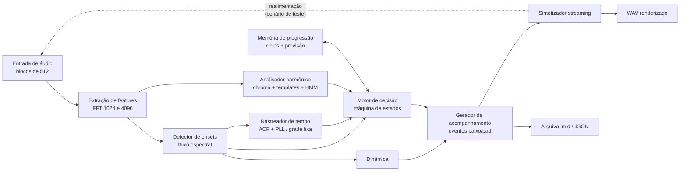
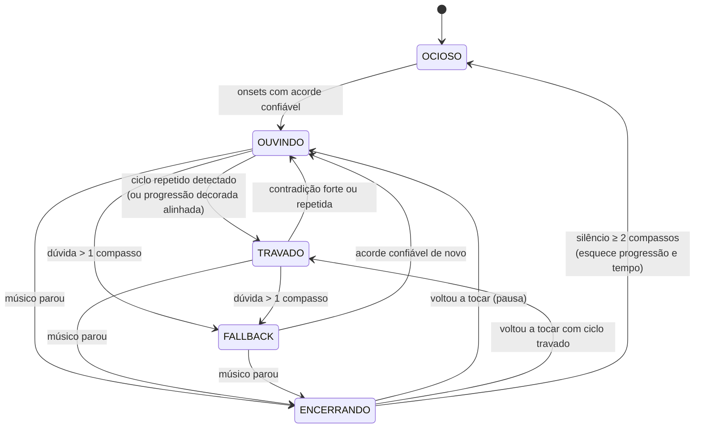
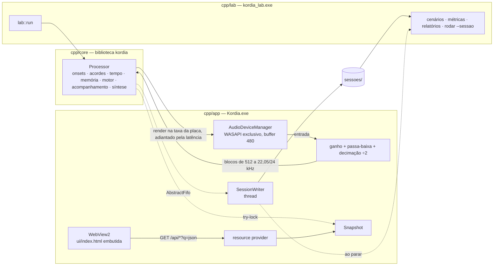

# 02 — Arquitetura

## Visão geral

Tudo roda em **streaming**: o áudio entra em blocos de 512 amostras (22 050 Hz, ≈ 23 ms) e cada módulo só usa o passado. A saída de um bloco vale a partir do bloco seguinte (1 bloco de latência estrutural), como seria em tempo real.

## Módulos

Núcleo (`cpp/core`, biblioteca `kordia`, sem JUCE):

| Arquivo | Responsabilidade | Interface principal |
|---|---|---|
| `include/kordia/core.h` | declarações e todos os parâmetros numéricos (`namespace P`), comentados | constantes, classes |
| `src/theory.cpp` | nomes de acordes, templates, prior por tom, detecção de tom | `chord_index`, `chord_pcs`, `key_prior`, `detect_key` |
| `src/analysis.cpp` | FFT com janela, fluxo espectral, limiar adaptativo, chromagram, filtro HMM causal | `Spectrum`, `OnsetDetector::process`, `ChordTracker::process` |
| `src/tempo.cpp` | rastreador adaptativo (ACF + PLL), grade fixa, sequência de acordes, detecção de ciclo, previsão | `Grid::update`, `TempoTracker`, `FixedGrid`, `ProgressionMemory::push/predict/push_slot` |
| `src/engine.cpp` | máquina de estados, escada de confiança, parada | `Engine::step(...) -> Output` |
| `src/accomp.cpp` | transforma decisões em eventos de nota (baixo/pad), dinâmica | `Accompanist::apply`, `Dynamics` |
| `src/synth.cpp` | sintetizador streaming estéreo: pad worship (serras + passa-baixa + reverb), camadas, baixo, clique, limitador | `Synth::render(t0, n, left, right)` |
| `src/processor.cpp` | `Processor`: o sistema inteiro, um bloco por vez | `render(...)`, `analyze(bloco)` |

Laboratório (`cpp/lab`, `kordia_lab.exe`) e testes (`cpp/tests`, `kordia_tests.exe`):

| Arquivo | Responsabilidade | Interface principal |
|---|---|---|
| `lab.h` | declarações do laboratório, formato da pasta de sessão | — |
| `rng.cpp`, `ziggurat_tables.h` | o gerador do NumPy (`default_rng`), bit a bit | `Rng` |
| `dsp.cpp` | soma por pares, `lfilter`, `resample_poly`, estatísticas, arredondamento, `parallel_for` | funções |
| `files.cpp` | WAV, JSON, leitura das sessões gravadas pelo app | `read_wav`, `Json`, `load_session` |
| `guitar.cpp` | voicings, síntese Karplus-Strong e batidas (só para gerar cenários) | `voicing`, `pluck`, `Guitar` |
| `scenarios.cpp` | os 14 cenários, áudio + verdade-base JSON | `build_scenario(nome) -> Song` |
| `metrics.cpp` | execução offline e comparação com a verdade-base | `run(audio, cfg) -> Result`, `evaluate(result, truth)` |
| `exam.cpp` | a prova e o controle com as sessões reais | `exam::build`, `exam::score`, `run_exam`, `run_controls` |
| `report.cpp` | WAV renderizado, MIDI, eventos e relatório SVG | `save_outputs`, `plot`, `write_midi` |
| `main.cpp` | `gerar`, `rodar`, `avaliar`, `prova` | — |

A interface (`cpp/app/ui/index.html`, HTML/CSS/JS) é embutida no `Kordia.exe` e fala com ele por `GET /api/<nome>?q=<json>`.

## Fluxo por bloco

1. Buffer circular recebe o bloco. Calcula-se FFT de 1024 (onsets) e de 4096 (harmonia) sobre as últimas amostras.
2. **Onsets:** fluxo espectral (log-magnitude, diferença positiva, 150 Hz–5 kHz) comparado com limiar adaptativo (mediana móvel × fator + delta), com período refratário. Cada onset sai com instante e intensidade (RMS em dB).
3. **Tempo:**
   - *Livre:* a envoltória de fluxo dos últimos ~8 s passa por autocorrelação a cada ~0,25 s; o pico ponderado por um prior log-normal (centrado em ~105 BPM) dá o período. Um PLL corrige fase e período a cada onset que cai perto de um tempo previsto (onsets de contratempo são ignorados). A **posição no compasso** (4/4) começa no primeiro onset e é corrigida pelas trocas de acorde confirmadas (as trocas tendem a cair no tempo 1). A confiança é a fração dos últimos tempos que tiveram onset alinhado.
   - *Metrônomo:* grade fixa com o BPM dado, iniciada no primeiro onset. Com clique ou contagem, ancorada no Iniciar.
4. **Harmonia:** chroma de 12 classes (60 Hz–2,5 kHz, compressão log) → similaridade de cosseno com templates de 24 acordes (maior/menor, com harmônicos) + estado "N" (sem acorde) → verossimilhança `exp(β·cos)` → **filtro HMM causal** (algoritmo forward). A probabilidade de troca por quadro é baixa (persistência) e aumenta logo após onsets em tempo forte (peso por posição). O prior de transição favorece acordes diatônicos do tom principal. A **confiança** não é o posterior do HMM (que satura em ~1): é um softmax por quadro suavizado, lido no acorde que o HMM escolheu.
   *Com clique (grade):* o `Processor` soma o cromagrama de cada meio compasso (`close_slot`), deslocado 80 ms pelo atraso medido das palhetadas e pulando os primeiros 100 ms, em que a janela ainda tem o acorde anterior. O `ProgressionMemory.push_slot` guarda essa soma; nada é decidido em quadro isolado.
5. **Motor de decisão** (abaixo) escolhe o que tocar e quando.
6. **Acompanhamento:** baixo na fundamental (oitava 2) atacando nos tempos 1 e 3 quando o tempo está confiável, sustentado caso contrário; pad com a tríade (oitava 4) sustentada até a troca. Velocity vem da dinâmica.
7. **Síntese:** sintetizador aditivo simples, streaming, com precisão de amostra.

## Máquina de estados

- **OCIOSO:** não toca nada. Memória vazia.
- **OUVINDO:** reativo. Troca o acompanhamento quando o acorde ouvido tem confiança alta **e** houve palhetada nos últimos 0,35 s. No modo metrônomo a troca espera o próximo tempo forte (1 ou 3) da grade.
- **TRAVADO com "manter o padrão"** (padrão da interface): a confirmação pelo áudio só serve para detectar mudança deliberada (discordância confiante por 1½ compasso); erros, dúvidas e atrasos são ignorados; a parada exige 5 tempos sem palhetada.
- **TRAVADO:** previsão. A troca é agendada no próximo tempo previsto para o acorde seguinte do ciclo (duração de cada acorde aprendida em meios compassos). ~½ pulso depois, o áudio confirma; se outro acorde for ouvido com alta confiança, toca o ouvido e destrava (e tenta re-travar no ciclo conhecido assim que dois acordes seguidos baterem com ele); continuar ouvindo o acorde anterior por até 1 pulso é tratado como atraso do músico; discordância fraca conta como "falha", e duas seguidas destravam.
- **Grade (clique, sem progressão conhecida):** não há escada de confiança nem troca reativa. Enquanto aprende, o motor segura a tônica; o ciclo trava quando uma volta de compassos inteiros (até 8) se repete em ≥ 75 % dos meios compassos, com os 3 últimos iguais e ao menos 2 fundamentais. Dali em diante cada meio compasso fechado recalcula o acorde de cada posição somando as últimas 3 voltas, e as trocas são agendadas pelo mesmo `predict()` do caminho antigo, sempre na grade. Maior × menor da mesma fundamental não conta como discordância: quem decide a terça é a soma das voltas. `GRID_MISS` (ou 3, com *manter o padrão*) meios compassos seguidos contra o padrão destravam.
- **Contagem:** com `contagem`, o motor não recebe nada até ¼ de tempo antes do primeiro tempo do compasso seguinte ao Iniciar, e 4 cliques soam mesmo com o Clique desligado.
- **FALLBACK:** pad na tônica + quinta do tom principal (ou silêncio sem tom).
- **ENCERRANDO:** termina o compasso da última palhetada, faz fade, e mantém memória por até ~2 compassos de silêncio.

Paralelo ao estado, cada quadro tem um **nível de confiança** (CONFIANTE / DÚVIDA / PERDIDO) que define a saída (ver `01-requisitos.md`, RF4).

## Parâmetros

Todos em `cpp/core/include/kordia/core.h` (`namespace P`), com unidade e motivo.

## Saídas do pipeline

- `eventos.json` e `.mid` (canal 1 baixo, canal 2 pad, CC11 para expressão);
- `*_render.wav`: violão original + baixo + pad;
- log por quadro (tempo, onset, BPM estimado, acorde ouvido, confiança, acorde tocado, estado, nível), usado por métricas e relatórios.

## Núcleo C++ e app JUCE

- **`cpp/core`** (`kordia`, biblioteca estática, sem JUCE): o motor, usado pelo app e pelo laboratório. FFT própria com tabelas prontas (`Spectrum`). Depois de construído, o `Processor` não aloca nada: filas fixas (`Ring`), motivos em buffer fixo e memórias de trabalho reservadas (`audio_path_does_not_allocate`). A taxa de análise é um parâmetro de execução: 22 050 Hz no laboratório; ao vivo, taxa da placa ÷ 2 (44,1 kHz → 22 050; 48 kHz → 24 000). A síntese roda na taxa da placa. Todos os tempos do algoritmo estão em segundos, então o resultado musical não depende da taxa (`test_core_is_rate_independent`).
- **`cpp/lab`** (`kordia_lab.exe`): `lab::run(audio, cfg, lookahead, sr)` roda o `Processor` num arquivo e devolve áudio, log por bloco, eventos e trocas. Cenários e prova usam o gerador do NumPy reproduzido bit a bit (`rng.cpp`), para medir as mesmas músicas de todas as versões.
- **`cpp/app`**: `LiveEngine` é o `AudioIODeviceCallback`. A entrada passa por ganho, por um passa-baixa FIR de 63 coeficientes e pela decimação; a cada 512 amostras chama `Processor::analyze`; a saída vem de `Processor::render` no tempo `amostras/taxa + latência` (o `lookahead`). A interface é a `index.html`, servida pelo *resource provider* do WebView2: ela usa `GET /api/<nome>?q=<json>` e consulta `/api/state` a cada 50 ms tocando, 100 ms parada e 500 ms minimizada. A página só escreve no DOM o que mudou, e os medidores usam `transform`, sem layout.
- **Compensação de latência (`lookahead`):** a latência informada pelo driver (entrada + saída) é passada ao `Processor`. O sintetizador renderiza esse tanto à frente; trocas previstas, fim do compasso, ataques do baixo e **cliques** são emitidos com esse adiantamento para soarem no tempo. Trocas reativas não têm como ser adiantadas.
- **Clique:** agendado no tempo previsto do rastreador (mesmo mecanismo do baixo). Com BPM fixo + clique, a `FixedGrid` é ancorada no Iniciar (0,5 s + latência), e não na primeira palhetada, e mantém a fase entre músicas. "Fixar BPM" congela o `TempoTracker` (sem PLL nem ACF).
- **Ouvir antes do Iniciar:** `LiveEngine::start(q, preview=true)` abre o áudio com um `Processor` sem tom nem clique e com a saída zerada, não cria sessão e mantém o diário da última música. `Main` expõe em `/api/listen`; `snapshot()` devolve `listening`, `heard`, `note`, `conf` e `db`. O Iniciar fecha esse modo e reabre o dispositivo.
- **O que ele entende:** `publish()` copia para o `Snap`, sem alocar, o cromagrama (0–100), os 3 acordes mais prováveis (`Processor::evidence`), os últimos 32 meios compassos com a nota de cada um (`ProgressionMemory::slot_labels`, `slot_scores`), a volta mais próxima de travar (`progress()`, que usa o mesmo `check_cycle` do `find_cycle`), os acordes em ordem sem clique (`recent_chords`) e o nível de cada camada (`Synth::layer_rms`). `/api/state` só manda o bloco `learn` enquanto ele aprende.
- **Sessões na interface:** `/api/sessions` lista, `/api/session` devolve configuração, resumo, decisões e colunas de ouvido × tocado. `report_columns` (`cpp/app/SessionReport.h`, sem JUCE, coberto por `session_report_reduces_the_frames_to_columns`) reduz o `quadros.csv` a ~160 colunas. O nome vem da página: `sessionFolder` só aceita pasta diretamente dentro de `sessoes/`. A lista não abre durante a música.
- **Teste de som:** `/api/live {testar_som}`, só no modo de ouvir. O callback soma ao fim do bloco uma nota de baixo sintetizada ali mesmo, pois nesse modo a saída do `Processor` está zerada.
- **Verificação de áudio:** `read_audio_system()` (`AudioCheck.cpp`) pergunta ao Windows pelas entradas, pela permissão de microfone e pelos dispositivos com problema; `diagnose()` (`AudioCheck.h`, sem Windows nem JUCE) decide o aviso. `Main` expõe em `/api/audio_check`, que a interface consulta a cada 3 s só com o app parado. A captura no modo compartilhado pede áudio cru, sem os efeitos de voz do Windows (patch em `cpp/app/CMakeLists.txt`).
- **Sessões**: o callback só enfileira; uma thread grava WAV, CSV e JSONL, indo ao disco a cada 2 s (`config.json` traz também `sr`, `motor`, `driver`, `buffer`; `cpp/lab/lab.h` descreve a pasta). Ao parar, o app chama `kordia_lab rodar --sessao <pasta> --saida <pasta>` para gerar o relatório; a interface mostra "relatório gerando", "pronto" ou "falhou".
