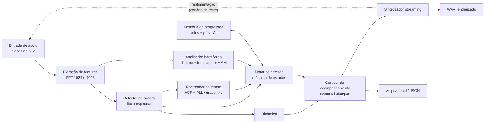
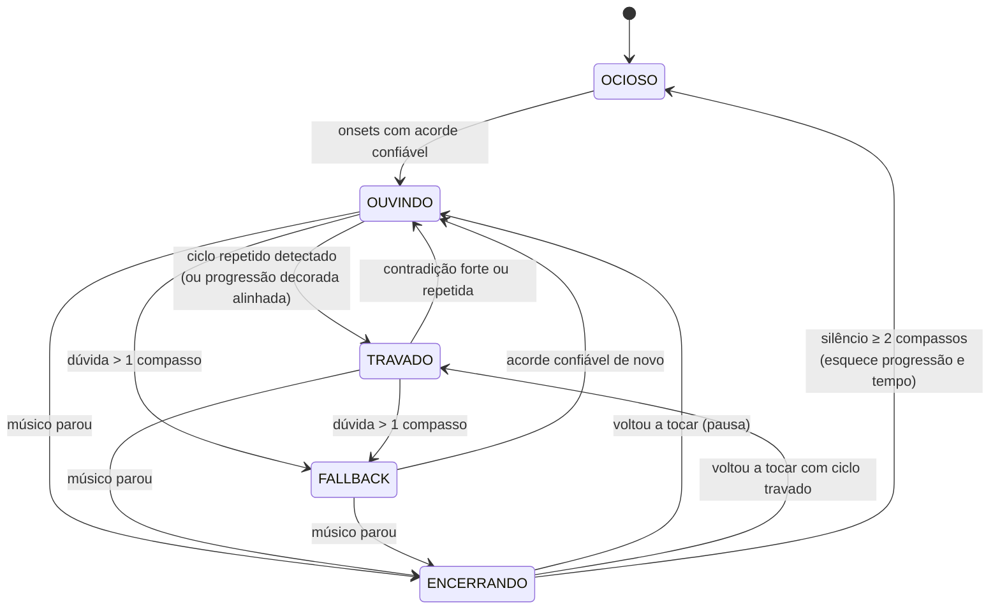
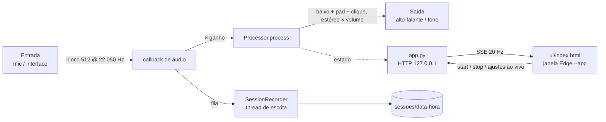

# 02 — Arquitetura

## Visão geral

Tudo roda em **streaming**: o áudio entra em blocos de 512 amostras (22 050 Hz, ≈ 23 ms) e cada módulo só usa o passado. A saída de um bloco vale a partir do bloco seguinte (1 bloco de latência estrutural), como seria em tempo real.

## Módulos (`acompanhante/`)

| Arquivo | Responsabilidade | Interface principal |
|---|---|---|
| `params.py` | todos os parâmetros numéricos, comentados | constantes |
| `theory.py` | nomes de acordes, voicings de violão, templates, prior por tom | `parse_chord`, `chord_pcs`, `key_prior` |
| `guitar.py` | síntese Karplus-Strong e batidas (só para gerar cenários) | `strum(...)` |
| `scenarios.py` | os 12 cenários, WAV + verdade-base JSON | `build(nome) -> (audio, truth)` |
| `onsets.py` | fluxo espectral, limiar adaptativo, intensidade | `OnsetDetector.process(mag, rms, t) -> Onset/None` |
| `chords.py` | chromagram, templates, filtro HMM causal | `ChordTracker.process(mag, t, ...) -> posterior` |
| `tempo.py` | rastreador adaptativo (ACF + PLL) e grade fixa | `.update(t, onset)`, `.bpm`, `.confidence`, `.beat_at(t)` |
| `memory.py` | sequência de acordes, detecção de ciclo, previsão | `ProgressionMemory.push/predict/unlock` |
| `engine.py` | máquina de estados, escada de confiança, parada, dinâmica | `Engine.step(...) -> decisão` |
| `accomp.py` | transforma decisões em eventos de nota (baixo/pad) | `Accompanist.update(...) -> [Event]` |
| `synth.py` | sintetizador streaming estéreo: pad worship (serras + passa-baixa + reverb), baixo, clique, limitador; escrita MIDI | `Synth.render(t0, n) -> (n, 2)`, `write_midi` |
| `pipeline.py` | `Processor`: o sistema inteiro, um bloco por vez; `run()` para arquivos | `Processor.process(bloco) -> saída`; `run(audio, cfg) -> Result` |
| `metrics.py` | compara resultado com verdade-base | `evaluate(result, truth) -> dict` |
| `report.py` | figura PNG por cenário | `plot(result, truth, path)` |
| `cli.py` | `gerar`, `rodar`, `avaliar`, `interface` | — |
| `app.py` | app ao vivo: servidor HTTP local + fluxo de áudio duplex (sounddevice) | `python -m acompanhante.app` |
| `ui/index.html` | interface (HTML/CSS/JS), aberta no Edge em modo app | `GET /`, `/api/*` |
| `session.py` | gravação e reprodução de sessões ao vivo | `SessionRecorder`, `load()` |

## Fluxo por bloco

1. Buffer circular recebe o bloco. Calcula-se FFT de 1024 (onsets) e de 4096 (harmonia) sobre as últimas amostras.
2. **Onsets:** fluxo espectral (log-magnitude, diferença positiva, 150 Hz–5 kHz) comparado com limiar adaptativo (mediana móvel × fator + delta), com período refratário. Cada onset sai com instante e intensidade (RMS em dB).
3. **Tempo:**
   - *Livre:* a envoltória de fluxo dos últimos ~8 s passa por autocorrelação a cada ~0,25 s; o pico ponderado por um prior log-normal (centrado em ~105 BPM) dá o período. Um PLL corrige fase e período a cada onset que cai perto de um tempo previsto (onsets de contratempo são ignorados). A **posição no compasso** (4/4) começa no primeiro onset e é corrigida pelas trocas de acorde confirmadas (as trocas tendem a cair no tempo 1). A confiança é a fração dos últimos tempos que tiveram onset alinhado.
   - *Metrônomo:* grade fixa com o BPM dado, iniciada no primeiro onset.
4. **Harmonia:** chroma de 12 classes (60 Hz–2,5 kHz, compressão log) → similaridade de cosseno com templates de 24 acordes (maior/menor, com harmônicos) + estado "N" (sem acorde) → verossimilhança `exp(β·cos)` → **filtro HMM causal** (algoritmo forward). A probabilidade de troca por quadro é baixa (persistência) e aumenta logo após onsets em tempo forte (peso por posição). O prior de transição favorece acordes diatônicos do tom principal. A **confiança** não é o posterior do HMM (que satura em ~1): é um softmax por quadro suavizado, lido no acorde que o HMM escolheu.
5. **Motor de decisão** (abaixo) escolhe o que tocar e quando.
6. **Acompanhamento:** baixo na fundamental (oitava 2) atacando nos tempos 1 e 3 quando o tempo está confiável, sustentado caso contrário; pad com a tríade (oitava 4) sustentada até a troca. Velocity vem da dinâmica.
7. **Síntese:** sintetizador aditivo simples, streaming, com precisão de amostra.

## Máquina de estados

- **OCIOSO:** não toca nada. Memória vazia.
- **OUVINDO:** reativo. Troca o acompanhamento quando o acorde ouvido tem confiança alta **e** houve palhetada nos últimos 0,35 s. No modo metrônomo a troca espera o próximo tempo forte (1 ou 3) da grade.
- **TRAVADO:** previsão. A troca é agendada no próximo tempo previsto para o acorde seguinte do ciclo (duração de cada acorde aprendida em meios compassos). ~½ pulso depois, o áudio confirma; se outro acorde for ouvido com alta confiança, toca o ouvido e destrava (e tenta re-travar no ciclo conhecido assim que dois acordes seguidos baterem com ele); continuar ouvindo o acorde anterior por até 1 pulso é tratado como atraso do músico; discordância fraca conta como "falha", e duas seguidas destravam.
- **FALLBACK:** pad na tônica + quinta do tom principal (ou silêncio sem tom).
- **ENCERRANDO:** termina o compasso da última palhetada, faz fade, e mantém memória por até ~2 compassos de silêncio.

Paralelo ao estado, cada quadro tem um **nível de confiança** (CONFIANTE / DÚVIDA / PERDIDO) que define a saída (ver `01-requisitos.md`, RF4).

## Parâmetros

Todos em `acompanhante/params.py`, com unidade e motivo. Ao portar para C++, esse arquivo é a especificação.

## Saídas do pipeline

- `eventos.json` e `.mid` (canal 1 baixo, canal 2 pad, CC11 para expressão);
- `*_render.wav`: violão original + baixo + pad;
- log por quadro (tempo, onset, BPM estimado, acorde ouvido, confiança, acorde tocado, estado, nível), usado por métricas e relatórios.

## Modo ao vivo

- O fluxo duplex é aberto a 22 050 Hz com bloco de 512 no host API padrão (MME no Windows reamostra sozinho). Medido: ~1 ms de processamento por bloco de 23 ms (pico de 3,6 ms).
- **Compensação de latência (`lookahead`):** a latência informada pelo driver (entrada + saída, ~115 ms no MME) é passada ao `Processor`. O sintetizador renderiza esse tanto à frente; trocas previstas, fim do compasso, ataques do baixo e **cliques** são emitidos com esse adiantamento para soarem no tempo. Trocas reativas não têm como ser adiantadas.
- **Clique:** agendado no tempo previsto do rastreador (mesmo mecanismo do baixo). Com BPM fixo + clique, a `FixedGrid` é ancorada no Iniciar (0,5 s + latência), e não na primeira palhetada, e mantém a fase entre músicas. "Fixar BPM" congela o `TempoTracker` (sem PLL nem ACF).
- **Sessões:** o callback só enfileira (bloco de entrada + linha de estado + decisões novas); uma thread grava WAV, CSV e JSONL. Ao parar, outra thread reproduz a sessão offline (`run(..., lookahead)`) e salva `relatorio.png`.
- **Janela:** `app.py` abre o Edge com `--app=` e um perfil próprio (`%LOCALAPPDATA%/kordia/edge`). Um watchdog encerra o áudio e o processo quando a janela fecha (nenhum cliente de eventos por 6 s).
- Sem log por quadro em memória no modo ao vivo (memória limitada); o log vai para o disco.
